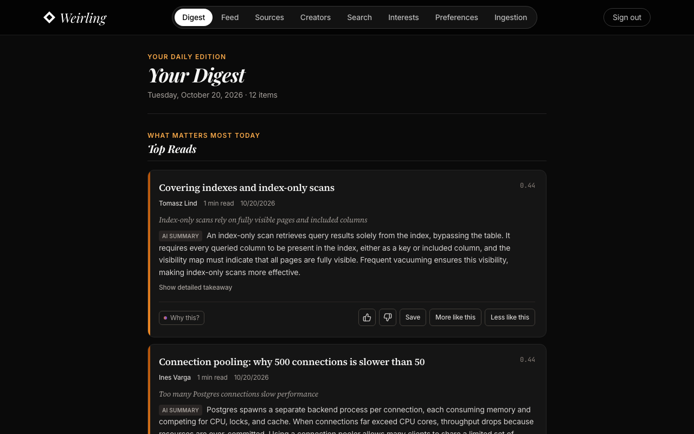
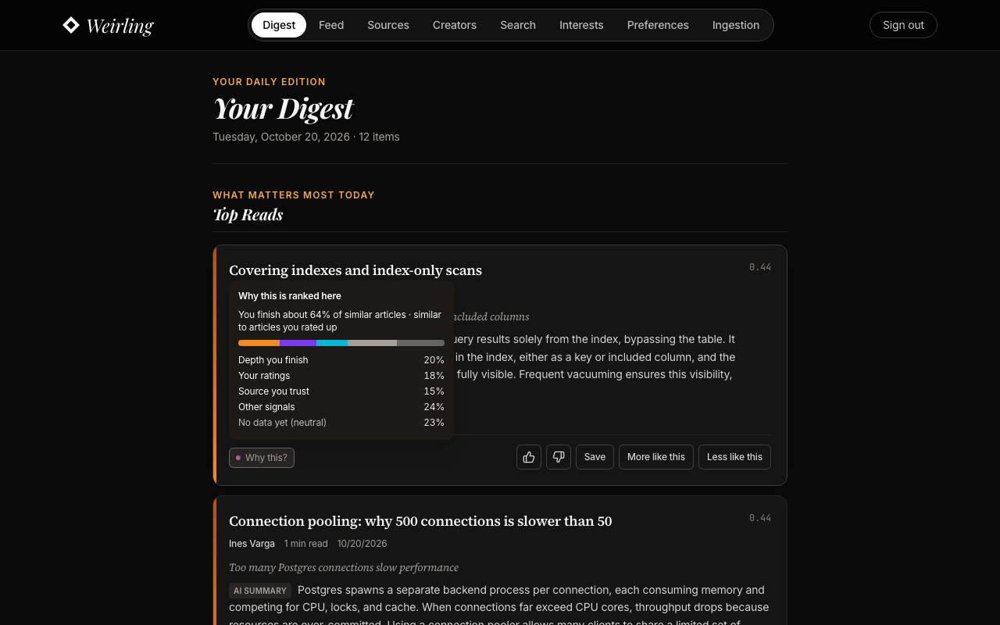
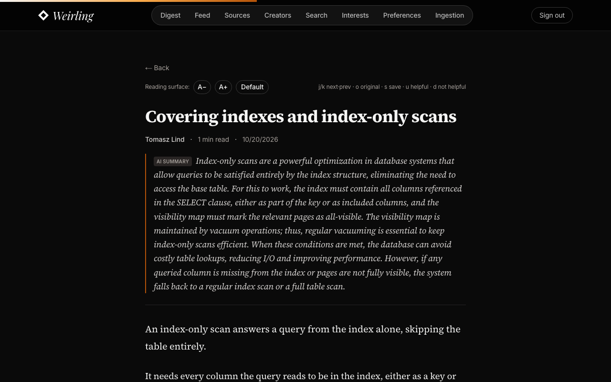
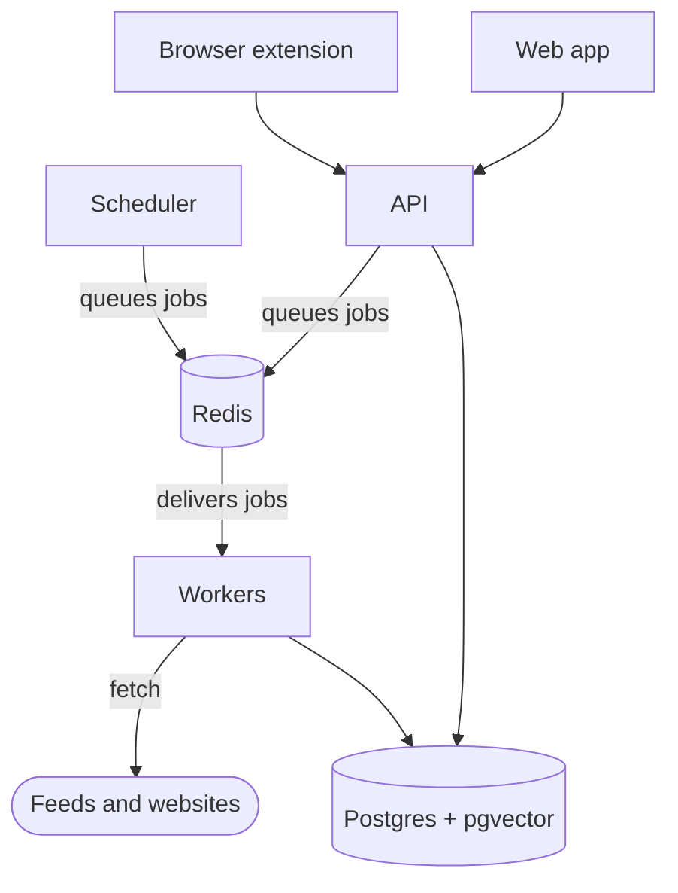

# Weirling

**The reading app that ranks by how you actually read.**

Weirling is a self-hostable reading tool that aggregates every source and creator you follow and orders your daily digest by personal relevance: a behavioral, explainable ranking engine that gets sharper the more you read.

What makes it different:

- **Behavioral, not keyword**: learns from real scroll depth and active reading time, not rules you maintain by hand (vs Feedly Leo).
- **Explainable**: every item shows why it ranked, and the interest graph names the topic connections (vs black-box feeds).
- **Honest and open**: the full ranking engine is free, closed platforms are marked unsupported rather than silently failing, and the code is open source and self-hostable.

**Who it's for:** built for developers and heavy readers who follow 50+ technical feeds: people who want an explainable, behavioral ranking engine that gets better the more they read. Weirling supports both single-tenant self-hosting and multi-tenant hosted operations.

The product specification is [`spec/PCIP_Proposal_V2.md`](spec/PCIP_Proposal_V2.md). Where the code has moved on, [`spec/PCIP_Proposal_V2_addendum.md`](spec/PCIP_Proposal_V2_addendum.md) records the decision. The documentation site is built from [`docs/`](docs/index.md): start with [Install & run](docs/DEPLOYMENT.md) or [Architecture](docs/ARCHITECTURE.md). Work status is [`docs/PROGRESS.md`](docs/PROGRESS.md); the reasoning behind the backlog is [`docs/ROADMAP.md`](docs/ROADMAP.md).

---

## Hosted or Self-Host

Weirling operates in two deployment modes controlled by `DEPLOYMENT_MODE` (`selfhost` or `hosted`):

- **Self-Hosted (`DEPLOYMENT_MODE=selfhost`, default)**: Single-tenant deployment with no quota or plan gates. All ingested content is readable in full text within the in-app reader (`READER_FULL_TEXT=auto`), email verification defaults to off (`EMAIL_VERIFICATION=auto`), and registration is closed after setup by default (`REGISTRATION_MODE=closed`) to protect your instance.
- **Hosted (`DEPLOYMENT_MODE=hosted`)**: Multi-tenant offering with Reader and Pro plans, a 30-day trial and per-plan quotas ([docs/HOSTING.md](docs/HOSTING.md)), mandatory email verification (`EMAIL_VERIFICATION=auto`), domain-level signup rate limits (`SIGNUP_PER_DOMAIN_PER_HOUR`), tenant fetch abuse controls (`HOSTED_FETCH_BUDGET_PER_HOUR`), reader full-text syndication safeguards (`READER_FULL_TEXT=auto`), and subscription billing via Lemon Squeezy or Paddle (`BILLING_PROVIDER`).

---

## Quickstart

```bash
./scripts/init_env.sh        # creates .env with generated secrets (add LLM_API_KEY optionally)
docker compose up -d          # pulls the published images, starts 8 services; migrations run automatically
open http://localhost:3001    # create your account and onboard
```

**Profiles**:
- **Default (`docker compose up -d`)**: ~2.5 GB RAM. Runs the standard 8 services with local MiniLM embeddings (`sentence-transformers/all-MiniLM-L6-v2`, 384-dimensional), Postgres FTS + pgvector search, and dedicated Celery solo workers.
- **Lite (`make up-lite`)**: ~1.0 GB RAM. Runs the torch-free `:latest-lite` image (built with `LITE=1`), so embeddings fall back to the deterministic lexical hash embedder (same 384-d column, weaker semantic matching). Search runs via Postgres FTS + pgvector. Ideal for low-memory VPS instances.
- **Full (`docker compose --profile full up -d`)**: ~3.5 GB RAM. Adds Browserless (headless Chrome pool in an isolated sandbox for rendering JS-heavy sites) and an egress proxy (Squid: the only route Browserless has to the internet, so a rendered page can't reach internal services). Search itself is Postgres FTS + pgvector; no separate search service. SSRF protection for every fetch is in the app (`safe_fetch` validates and pins IPs).
- **Bridge (`docker compose --profile bridge up -d`)**: Adds an RSSHub service to bridge closed platforms lacking RSS feeds.
- **Build from source (`make up-build`)**: builds the images from your checkout instead of pulling them from GHCR (`docker-compose.build.yml`; no source mounts).

**Operations**:
- `make backup` / `make restore FILE=backups/readprism-<ts>.tar.gz`: verified round-trip in CI.
- `make demo`: seed a demo persona (Maya, a backend engineer): seven fictional publications, two weeks of reading history and a real digest. All demo content is fictional, written for Weirling and released CC0 (`backend/app/data/demo/articles.json`).
- `make starter-pack-check`: verify starter-pack feed liveness (>=90%).

## Demo

[](frontend/public/landing/weirling-demo.mp4)

*40 seconds, narrated, captions on screen. Click to play.*

## Screenshots







*Full shot list and refresh instructions are in [`docs/MEDIA.md`](docs/MEDIA.md).*

---

## What It Does

- **Unified ingestion**: RSS/Atom feeds, robust web scraping (trafilatura + Playwright fallback), newsletter forwarding, and creator tracking across Substack, YouTube, Medium, Bluesky, Mastodon, GitHub, podcasts (via iTunes lookup), and any blog with RSS autodiscovery.
- **Personalized Relevance Score (PRS)**: Eight signal dimensions combined with per-user learned weights rank every item before it reaches your digest.
- **Real reading telemetry**: An in-app reader captures genuine scroll depth, active reading time (paused on idle/hidden), and reached-end, feeding the behavioral signals (`reading_depth`, `temporal_context`, `suggestion`, `novelty`) with real data instead of a tab-switch heuristic.
- **Daily digest**: Sectioned into lead items, creator updates, deep reads, and discovery content, delivered by email and readable in-app.
- **Interest graph**: Your reading history is stored as a directed weighted graph of topics, not a flat keyword list, enabling transitive relevance and explainable rankings.
- **Cold start handling**: Onboarding extracts high-quality initial signal immediately via topic priors, seed sources, and starter packs. Exploration slots ensure continuous serendipity. For multi-user setups, collaborative filtering warmup (`COLD_START_COLLABORATIVE_ENABLED`) suggests articles at least 20 readers finished (k-anonymous, opt-out in Preferences) once the instance has 100 active readers (inert on single-user and family instances).
- **Honest platform tiers**: Each tracked platform is shown as fully tracked / best-effort / unsupported, so you know what will and won't surface (X, LinkedIn and Reddit have no usable public feed and are clearly marked).

---

## Requirements & Prerequisites

- **Docker & Docker Compose (v2)**: Recommended for containerized deployment.
- **Host Python ≥ 3.11**: Required if running backend tests, CLI tools, or development servers outside Docker (uses PEP 604 union syntax `X | Y` and modern typing features; Python 3.12 recommended).
- **Node.js ≥ 20.9.0**: Required if running the frontend dev server or tests outside Docker.
- **RAM**:
  - ~1.0 GB RAM for the `lite` profile (hash embeddings)
  - ~2.5 GB RAM for the default self-host profile (MiniLM sentence-transformers)
  - ~3.5 GB RAM minimum for the `full` profile (MiniLM + Browserless)
- **LLM API Key (Optional)**: Groq (default), OpenAI, or any OpenAI-compatible provider. If unset, Weirling automatically falls back to extractive summaries (`summary_source=extractive`) with zero API dependencies.
- **SMTP Credentials (Optional)**: Any standard SMTP provider (Zoho, Postmark, SendGrid, etc.) for daily email digest delivery. If omitted, digests are still compiled and accessible in-app.

---

## Setup

### 1. Clone and configure environment

```bash
git clone https://github.com/mohitmishra786/weirling.git
cd weirling
./scripts/init_env.sh   # copies .env.example to .env and generates SECRET_KEY, REFRESH_SECRET_KEY, METRICS_TOKEN
```

The app runs in production mode by default and refuses to start without a strong
`SECRET_KEY`. Then fill in the optional values in `.env`:

```env
LLM_API_KEY=<your Groq (or other OpenAI-compatible) API key>
ZOHO_EMAIL=<your SMTP username>
ZOHO_PASSWORD=<your SMTP app password>
FROM_EMAIL=digest@yourdomain.com
FRONTEND_URL=http://localhost:3001
```

`LLM_API_KEY` (or the legacy, deprecated `GROQ_API_KEY`, removed in v0.3) is optional: without a key, the digest still builds using extractive summaries. Without email credentials, digests are still readable in-app (email delivery is skipped). All other values have working defaults for local development.

### 2. Start the stack

```bash
docker compose up -d      # or `make up-build` to build from this checkout
```

For local development (`APP_ENV=development`, `--reload`, source mounts) use
`make up-dev`, which adds `docker-compose.dev.yml`. Never expose a development
instance: it relaxes webhook authentication and opens operator metrics.

This starts eight services by default:

| Service | Port | Description |
|---|---|---|
| `db` | 5432 | PostgreSQL 16 with pgvector extension |
| `redis` | 6379 | Cache and Celery broker |
| `backend` | 8000 | FastAPI application server |
| `worker-scrape` | None | Celery solo worker for fetching and scraping feeds (`scrape` queue) |
| `worker-embed` | None | Celery solo worker for computing semantic embeddings (`embed` queue) |
| `worker-digest` | None | Celery solo worker for compiling and delivering digests (`digest`, `celery` queues) |
| `beat` | None | Celery beat scheduler for periodic tasks |
| `frontend` | 3001 | Next.js web application |

Additional services are enabled with profiles:
- **`--profile full`**: `browserless` (port 3000, internal headless Chrome pool on an isolated network) and `egress-proxy` (Squid forward proxy; Browserless's only way out).
- **`--profile bridge`**: `rsshub` (port 1200, RSSHub bridge for closed platforms).

### 3. Migrations

The backend applies database migrations automatically on start (under a lock,
so several replicas never race). Set `AUTO_MIGRATE=false` to run them yourself
with `docker compose exec backend python -m app.migrate`.

### 4. Open the app

Navigate to [http://localhost:3001](http://localhost:3001) and create an account. The onboarding wizard collects your interests, sample article ratings, and optionally imports an OPML file from an existing RSS reader.

---

## Architecture



| Piece | What it does |
|---|---|
| Web app (port 3001) | Next.js reader, digest, sources and settings |
| API (port 8000) | FastAPI, everything under `/api/v1` |
| Workers | Celery, one queue each: `scrape`, `embed`, `digest` |
| Scheduler | Celery beat: polls, digests, emails, upkeep |
| Postgres + pgvector | Users, feeds, items, vectors, digests |
| Redis | Task broker, cache, rate limits |

**How an item flows:** a feed is fetched once for all its subscribers,
duplicates are dropped, the item is stored and embedded locally
(`all-MiniLM-L6-v2`, no API cost). When a digest is built, the ranker scores
candidates for that reader, and a model summary is written only for the items
shown (on the fast model; without a key, an extract is used). More, with
diagrams: [docs/ARCHITECTURE.md](docs/ARCHITECTURE.md).

---

## Ranking Engine

Every candidate gets eight signal scores between 0 and 1. Each is multiplied
by your personal weight, and the products add up to its **Personalized
Relevance Score (PRS)**. The largest products become the plain-language reason
shown next to the item, so the explanation always matches the math.

| Signal | What it measures |
|---|---|
| `semantic` | Closeness to the topics in your interest graph |
| `reading_depth` | How far you read similar articles (scroll depth and active time from the in-app reader) |
| `suggestion` | How often you accept discovery picks like it |
| `explicit_feedback` | Thumbs, saves and reason tags |
| `source_trust` | How your reading of this source has gone |
| `content_quality` | Length, citations and depth |
| `temporal_context` | Freshness over three horizons, less for repeats of one event |
| `novelty` | Distance from what you read in the last 30 days |

Weights are learned per reader from pairs in the same digest (the item you
opened against the one you skipped). A signal with no evidence stays neutral
and isn't used in the explanation. Your interests form a weighted topic graph
that decays over time, so ranking follows what you read now. Details:
[docs/signals.md](docs/signals.md).

---

## Development Guide

### Running tests

```bash
docker compose exec backend pytest tests/ -v
```

Or locally with a running database and Redis (requires host Python ≥ 3.11):

```bash
cd backend
pip install -r requirements.txt
pytest tests/ -v
```

### Local Celery (without Docker)

```bash
# Terminal 1: worker
cd backend
celery -A app.workers.celery_app worker --loglevel=info

# Terminal 2: beat scheduler
celery -A app.workers.celery_app beat --loglevel=info
```

### Frontend dev server

```bash
cd frontend
npm install
npm run dev   # http://localhost:3000
```

Set `NEXT_PUBLIC_API_URL=http://localhost:8000` in `frontend/.env.local`.

### Database migrations

```bash
# Inside the backend container or virtualenv
alembic upgrade head          # apply all migrations
alembic revision --autogenerate -m "description"  # generate new migration
alembic downgrade -1          # roll back one migration
```

### API documentation

FastAPI generates interactive docs at:
- Swagger UI: [http://localhost:8000/docs](http://localhost:8000/docs)
- ReDoc: [http://localhost:8000/redoc](http://localhost:8000/redoc)

---

## Key Environment Variables

Weirling is configured via environment variables. Run `./scripts/init_env.sh` to generate a ready-to-use `.env` file with secure random keys.

### Core Application & Deployment

| Variable | Default | Description |
|---|---|---|
| `APP_ENV` | `production` | `production` or `development`. Production enforces secure cookies and disables dev metric leaks. |
| `DEPLOYMENT_MODE` | `selfhost` | `selfhost` (single-tenant, no quotas, full-text reading) or `hosted` (multi-tenant safety, quotas, billing). |
| `SECRET_KEY` | *(Required)* | JWT signing secret key (generate with `./scripts/init_env.sh`). |
| `REFRESH_SECRET_KEY` | Falls back to `SECRET_KEY` | Optional separate secret for JWT refresh tokens. |
| `METRICS_TOKEN` | *(Required)* | Secret token gating `/metrics/*` endpoints via `X-Metrics-Token`. |
| `REGISTRATION_MODE` | `closed` (selfhost) / `open` (hosted) | `closed` (only initial user), `invite` (`REGISTRATION_INVITE_CODES`), or `open`. |
| `EMAIL_VERIFICATION` | `auto` | `auto` (required on hosted, off on selfhost), `required`, or `off`. |
| `FRONTEND_URL` | `http://localhost:3001` | Origin used for CORS headers and email link generation. |
| `PUBLIC_API_URL` | `http://localhost:8000` | Externally-reachable API URL used for email unsubscribe links. |
| `COOKIE_DOMAIN` | Empty (host-only) | Domain for session cookies; set e.g. `.example.com` for cross-subdomain auth. |
| `COOKIE_SECURE` | `auto` | `auto` enforces HTTPS cookies unless running on localhost/LAN HTTP. |

### Hosted & Abuse Controls

| Variable | Default | Description |
|---|---|---|
| `BILLING_PROVIDER` | Empty (disabled) | `lemonsqueezy` or `paddle` for hosted subscriptions. |
| `BILLING_WEBHOOK_SECRET` | Empty | Webhook signature verification secret for billing provider. |
| `BILLING_API_KEY` | Empty | API key for billing provider API operations (Paddle portal/checkout). |
| `READER_FULL_TEXT` | `auto` | `auto` (hosted serves feed text only; selfhost serves full extracted text), `all`, or `feed_only`. |
| `HOSTED_FETCH_BUDGET_PER_HOUR` | `300` | Per-user hourly feed fetch budget on hosted instances. |
| `HOSTED_HOST_POLLS_PER_HOUR` | `120` | Max times any single feed host is polled per hour across users. |
| `HOSTED_MAX_SOURCES_PER_HOST` | `10` | Max sources a single hosted user may subscribe to on the same host. |
| `SIGNUP_PER_DOMAIN_PER_HOUR` | `10` | Hosted registration rate limit per email domain per hour. |
| `DIGEST_ON_TIME_SECONDS` | `900` | Digest delivery SLO threshold in seconds (15 minutes). |
| `TELEMETRY_RAW_RETENTION_DAYS` | `90` | Raw reading telemetry retention in days (`0` keeps indefinitely). |

### Database & Redis

| Variable | Default | Description |
|---|---|---|
| `DATABASE_URL` | `postgresql+asyncpg://readprism:readprism@db:5432/readprism` | Async SQLAlchemy database URL (PostgreSQL + pgvector). |
| `DATABASE_SYNC_URL` | `postgresql+psycopg2://...` | Sync connection URL for migrations and healthchecks. |
| `AUTO_MIGRATE` | `true` | Automatically run Alembic migrations on backend startup under an advisory lock. |
| `REDIS_URL` | `redis://redis:6379/0` | Redis instance used for caching, rate limiting, and sessions. |
| `CELERY_BROKER_URL` | `redis://redis:6379/1` | Celery broker URL. |
| `CELERY_RESULT_BACKEND` | `redis://redis:6379/2` | Celery result backend URL. |

Redis is persistent: the compose service runs with AOF (`--appendonly yes --appendfsync everysec`) on the `redis_data` volume, so a restart or upgrade keeps logged-in sessions (refresh-token allowlist) and pending magic links (#204). `make backup` snapshots the store (BGSAVE) and `make restore` clears the AOF directory before loading the snapshot.

### LLM Summarization

| Variable | Default | Description |
|---|---|---|
| `LLM_BASE_URL` | `https://api.groq.com/openai/v1` | OpenAI-compatible API base URL (Groq, OpenAI, Ollama, etc.). |
| `LLM_API_KEY` | Empty (extractive) | Optional API key. When unset, extractive summaries are used without API calls. |
| `LLM_MODEL_PRIMARY` | `openai/gpt-oss-120b` | Large model: story synthesis and interest expansion. |
| `LLM_MODEL_FAST` | `openai/gpt-oss-20b` | Fast model: item summaries and topic extraction. |
| `LLM_MODEL_SUMMARY`, `_TOPICS`, `_SYNTHESIS`, `_INTERESTS` | Empty | Override the model for one task. See [docs/DEPLOYMENT.md](docs/DEPLOYMENT.md#which-model-does-what-225). |
| `LLM_SUMMARIZE` | `lazy` | `lazy` summarizes only items placed in digests or reader; `all` summarizes every ingest. |
| `OPENAI_FALLBACK_ENABLED` | `false` | Enable secondary OpenAI fallback provider (`OPENAI_API_KEY`, `OPENAI_MODEL`). |

### Embeddings & Ranking

| Variable | Default | Description |
|---|---|---|
| `EMBEDDING_MODEL` | `all-MiniLM-L6-v2` | Sentence-transformers model name or `hash` for torch-free hash embeddings. |
| `EMBEDDING_DEVICE` | `cpu` | PyTorch device (`cpu` or `cuda`). |
| `COLD_START_COLLABORATIVE_ENABLED` | `true` | Enable k-anonymous collaborative warmup (active from 100 readers; items need 20 distinct readers). |
| `SERENDIPITY_DEFAULT_PERCENTAGE` | `15` | Percentage of digest slots reserved for exploration/serendipity. |
| `RANKER_VERSION` | `2` | Active ranking engine algorithm version. |

### Email Delivery & Scraping

| Variable | Default | Description |
|---|---|---|
| `ZOHO_EMAIL` / `ZOHO_PASSWORD` | Empty | SMTP credentials for email digest delivery (email skipped if unset). |
| `FROM_EMAIL` | Empty | Sender address for outgoing digest emails. |
| `EMAIL_PHYSICAL_ADDRESS` | Empty | Physical mailing address included in digest email footer (CAN-SPAM). |
| `SSRF_PROTECTION_ENABLED` | `true` | Pin and validate resolved IPs against loopback/private CIDRs. |
| `BROWSERLESS_URL` | `http://browserless:3000` | Headless Chrome URL for rendered scraping (`full` profile). |
| `RSSHUB_BASE_URL` | Empty | Optional RSSHub bridge URL for closed platform feeds (`bridge` profile). |

All variables are documented in detail in [`.env.example`](.env.example).

---

## Scheduled Tasks

| Task | Schedule | Description |
|---|---|---|
| `ingest_all_feeds` | Every 30 minutes | Fetches and processes all active RSS/scraped sources |
| `ingest_creator_feeds` | Every 60 minutes | Fetches content from tracked creators across platforms |
| `schedule_daily_digests` | Daily at 05:00 UTC | Builds and queues digest delivery for all users |
| `apply_decay_all_users` | Daily at 02:00 UTC | Applies exponential decay to all interest graph node weights |
| `prune_old_full_text` | Daily at 03:30 UTC | Truncates stored article text to an excerpt after the retention window |

---

## Project Structure

```
readprism/
├── spec/PCIP_Proposal_V2.md          # Product specification (source of truth)
├── .env.example                       # All environment variables with descriptions
├── docker-compose.yml                 # Production-equivalent local stack
├── docker-compose.dev.yml             # Local dev overrides (opt-in: make up-dev)
├── backend/
│   ├── Dockerfile
│   ├── requirements.txt               # All Python deps pinned
│   ├── alembic.ini
│   ├── init.sql                       # pgvector extension initialization
│   ├── templates/digest_email.html    # Jinja2 email template
│   ├── migrations/
│   │   └── versions/                  # 0001 initial … 0006 content owner_user_id (per-user private content)
│   ├── tests/                         # pytest suite
│   └── app/
│       ├── main.py                    # FastAPI app factory + lifespan
│       ├── config.py                  # pydantic-settings BaseSettings
│       ├── database.py                # Async SQLAlchemy engine + session
│       ├── models/                    # SQLAlchemy ORM models (6 files)
│       ├── schemas/                   # Pydantic v2 request/response schemas (6 files)
│       ├── api/                       # FastAPI routers (8 endpoint files)
│       ├── utils/                     # embeddings, cache, email, logging
│       ├── workers/
│       │   ├── celery_app.py
│       │   ├── schedules.py
│       │   └── tasks/                 # 6 Celery task files
│       └── services/
│           ├── ingestion/             # rss_parser, scraper, newsletter, dispatcher
│           ├── ranking/               # engine, scorer, meta_weights + 8 signal modules
│           ├── interest_graph/        # graph, updater, decay
│           ├── digest/                # builder, sections, delivery
│           ├── summarization/         # groq_client, openai_client, summarizer
│           ├── creator/               # resolver, tracker
│           └── cold_start/            # onboarding, collaborative
└── frontend/
    ├── Dockerfile
    ├── package.json                   # All deps pinned (Next.js 16, React 19)
    ├── tsconfig.json
    ├── next.config.ts
    └── src/
        ├── app/                       # Next.js App Router pages (incl. /read/[id] in-app reader)
        ├── components/                # digest, onboarding, sources, creators, PlatformBadge
        └── lib/                       # types.ts, api.ts, auth.ts, useReadingTelemetry.ts
```

---

## Legal & Privacy

- [Privacy Policy](docs/PRIVACY.md): what's collected, retention, and your export/erasure controls
- [Terms of Service](docs/TERMS.md)
- [Third-party services & compliance](docs/THIRD_PARTY_SERVICES.md)
- [Security policy](SECURITY.md) · [Contributing (+ CLA)](CONTRIBUTING.md)
- [Competitive landscape (2026)](docs/COMPETITORS.md) · [Unit economics](docs/UNIT_ECONOMICS.md)

These are baseline templates for the software; a hosted operator should have them
reviewed by counsel before collecting user data. Licensed under
[MIT](LICENSE).

---

## Technology Stack

| Component | Technology |
|---|---|
| Backend API | Python 3.12 / FastAPI (host-side tests/tools require Python ≥ 3.11) |
| Frontend | Next.js 16 (React 19, TypeScript) |
| Database | PostgreSQL 16 + pgvector |
| Cache & Queue | Redis 7 + Celery |
| Embeddings | sentence-transformers (`all-MiniLM-L6-v2`, local, no API cost; or hash embeddings in `lite` profile) |
| Summarization LLM | OpenAI-compatible HTTP (`LLM_BASE_URL` + `LLM_MODEL_*`). Default host is Groq with `openai/gpt-oss-120b` and `openai/gpt-oss-20b`. Optional; falls back to extractive summarization. |
| Email delivery | SMTP (Zoho by default) |
| Scraping | trafilatura + Playwright / Browserless (in `full` profile) |
| ORM | SQLAlchemy 2.0 (async) |
| Migrations | Alembic |
| Validation | Pydantic v2 |
