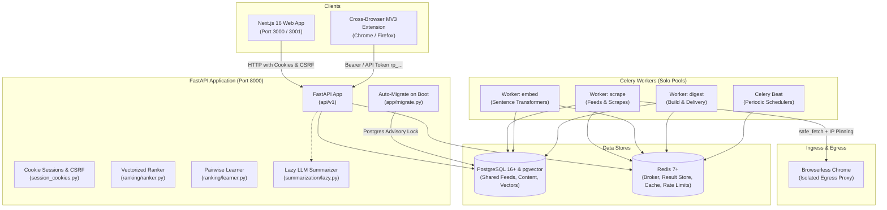
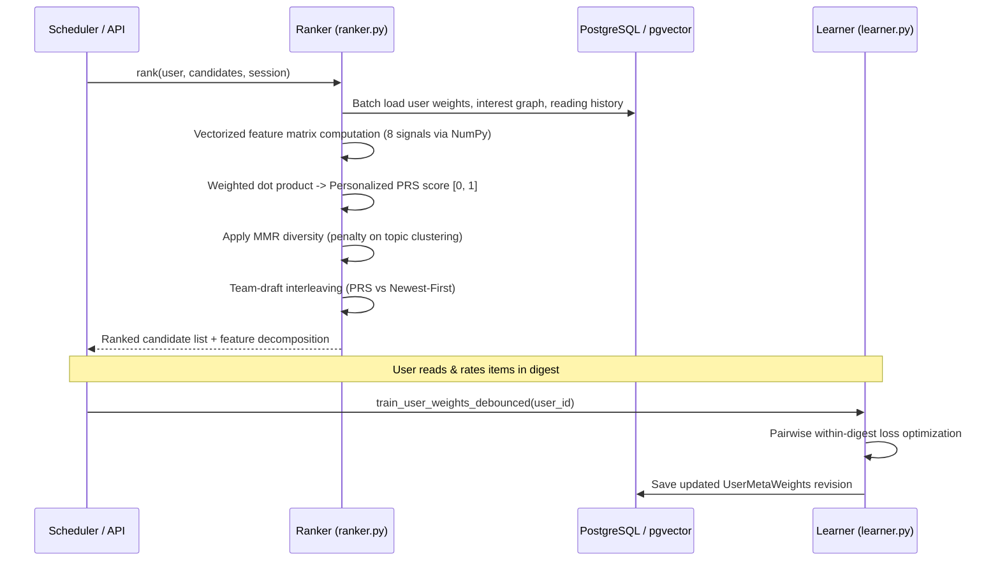

# System Architecture

ReadPrism is a personal reading digest service that aggregates RSS feeds, newsletters, and creator profiles, summarizes articles, and ranks a daily digest using a personal behavioral ranker.

It is designed to run in two deployment modes:
- **`DEPLOYMENT_MODE=selfhost`** (default): fully featured personal instance, closed registration by default, unlimited sources, zero billing or usage budgets.
- **`DEPLOYMENT_MODE=hosted`**: multi-tenant production SaaS with mandatory email verification, rate limits, source/fetch abuse controls, and subscription billing.

---

## 1. High-Level Component Topology

### Worker Concurrency
Celery workers run with `--pool=solo` (`docs/adr/0001-celery-solo-pool.md`) so that `asyncpg` connection pools are never shared across disparate asyncio event loops in child processes. Tasks are strictly routed to named queues (`scrape`, `embed`, `digest`).

---

## 2. Ingestion & Shared Feeds

### Shared Feeds Pipeline
Subscriptions are separated into per-user subscriptions (`sources` table) and instance-wide polling rows (`feeds` table):
- **Shared Identity**: `Feed.key = coalesce(feed_url, url)`. $N$ users subscribing to the same RSS feed trigger only a single network fetch per poll cycle.
- **State Mirroring**: `app/services/ingestion/feeds.py` (`mirror()`) copies HTTP etags, Last-Modified headers, poll intervals, error states, and dead notices onto every subscriber's `Source` row after each poll.
- **Adaptive Scheduling**: `app/services/ingestion/schedule.py` dynamically adjusts poll intervals between 15 minutes and 24 hours based on recent publication cadence, backing off exponentially on HTTP errors and honoring `Retry-After`.
- **SSRF Defense with IP Pinning**: `app/utils/ssrf.py` validates public IPs before network requests. `safe_fetch` connects directly to the validated IP literal while preserving the original `Host` and TLS SNI headers, eliminating DNS rebinding vulnerabilities. Local homelab exemptions are opt-in via `SIDECAR_ALLOW_PRIVATE_HTTP`.
- **Content Deduplication**: Ingested items are deduplicated across three layers: canonical URL normalization, GUID matches, and SimHash Hamming distance for near-duplicate article text.
- **Platform Connectors**:
  - Fully tracked: Substack, Medium, YouTube, Bluesky, Mastodon, GitHub.
  - Best-effort: Blogs and podcasts (via iTunes search autodiscovery).
  - Unsupported: Twitter/X, LinkedIn, and Reddit (RSS retired on 2026-11-13). Unsupported platforms surface clear UI warnings and never error-loop.

---

## 3. The Personal Ranking Engine

ReadPrism replaced per-item signal modules with a unified, vectorized ranking pipeline (`app/services/ranking/ranker.py`):

### Feature Decomposition
Every candidate is evaluated on 8 orthogonal features normalized to $[0, 1]$ before consumption:
1. `semantic`: Cosine similarity against interest-graph nodes and bridge midpoints.
2. `reading_depth`: Similarity-weighted historical completion of opened articles.
3. `suggestion`: Acceptance/completion rate for discovery items.
4. `explicit_feedback`: Closeness to thumbs-up articles minus thumbs-down penalties.
5. `source_trust`: Beta posterior of reading outcomes on this specific feed with the user's prior.
6. `content_quality`: Text length, citation structure, and depth heuristics.
7. `temporal_context`: Age decay with same-event saturation penalties.
8. `novelty`: Semantic distance from the last 30 days of user reading history.

When evidence is missing, features default to a neutral `0.5`, contributing zero gradient to pairwise learning.

### Diversity & Experimentation
- **MMR (Maximal Marginal Relevance)**: Penalizes semantic redundancy among top candidates to prevent single-topic monopolization.
- **Team-Draft Interleaving**: Alternates selections between the personalized ranker and a newest-first baseline to continuously measure ranking win-rate in production without degrading reading flow.
- **Pairwise Learning**: Weights are trained on within-digest preference pairs (opened vs skipped items within the same digest) rather than noisy absolute clicks, debounced per user.

---

## 4. Digest Building & Summarization

### Assembly & Sections
`app/services/digest/builder.py` personalizes sections for each reader:
- **Lead Section**: Top-scoring articles.
- **From Your Creators**: Grouped by creator (max 2 items per creator).
- **Deep Reads**: High-scoring long-form content ($\ge 8$ min reading time).
- **Discovery**: Serendipity picks from the Discovery Pool (`app/services/discovery/pool.py`), surfacing outbound links and starter-pack items matching interest clusters.
- **More From Your Feeds**: Fills remaining capacity to target length.

### Dynamic Digest Length & Schedule
- **Adaptive Length**: `digest_max_items` dynamically tracks $1.25 \times \text{EMA}(\text{opened items})$, clamped to $[5, 30]$ unless explicitly locked by user preference.
- **Zoneinfo Delivery**: Digests fire within a $\pm 15$-minute window around the user's preferred local time slot, with frequency deduplication windows (12h daily, 6h twice-daily, 84h weekly) preventing duplicate builds.

### Lazy LLM Summarization
Rather than invoking LLMs on all ingested articles, summarization is lazy (`app/services/summarization/lazy.py`):
1. Ingestion extracts a clean fallback text brief.
2. An LLM summary is only generated when an item is placed in a delivered digest or explicitly opened in the app.

---

## 5. Security, Sessions, and Operations

### Cookie Authentication & CSRF
- Browser credentials are stored in `httpOnly`, `SameSite=Lax` secure cookies (`readprism_access`, `readprism_refresh`).
- Mutating endpoints verify double-submit CSRF tokens via `x-csrf-token` header.
- Scoped API tokens (`rp_<hash>`) provide secure programmatic access for CLI tools and the browser extension.

### Database Migrations
Migrations execute via `app/migrate.py` on startup under Postgres advisory lock `7302410126`. When multiple API or worker containers start simultaneously, exactly one runs migrations while others wait.

### Hosted Multi-Tenancy & Abuse Controls
Under `DEPLOYMENT_MODE=hosted`:
- User registration enforces email confirmation (`app/services/email_verification.py`).
- Feed fetching enforces hourly host poll limits and account-level fetch budgets (`app/services/abuse.py`).
- Source limits and subscriber tiers are gated by LemonSqueezy/Stripe webhooks (`app/services/billing.py`).
- Full-text retention pruning runs on beat schedule to manage storage growth.

### Queue Metrics & Observability
Celery task wait times, run durations, and queue latencies are instrumented in `app/workers/queue_metrics.py` and exposed at `GET /api/v1/metrics/queues` guarded by `METRICS_TOKEN`.
