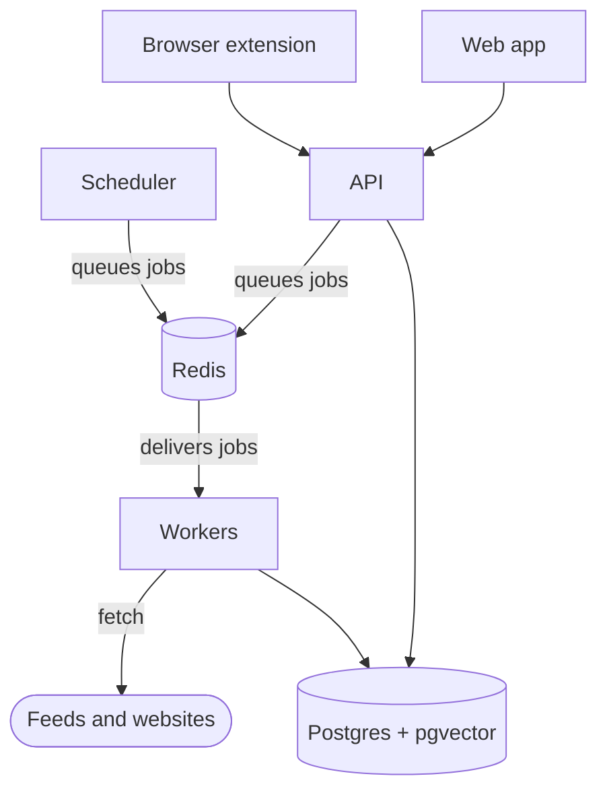
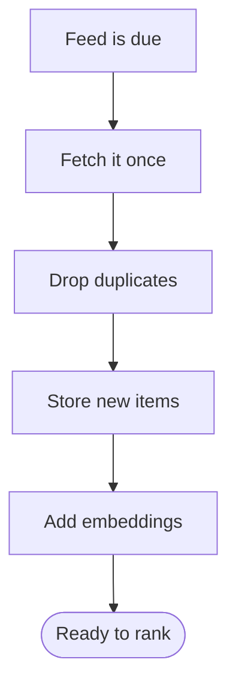
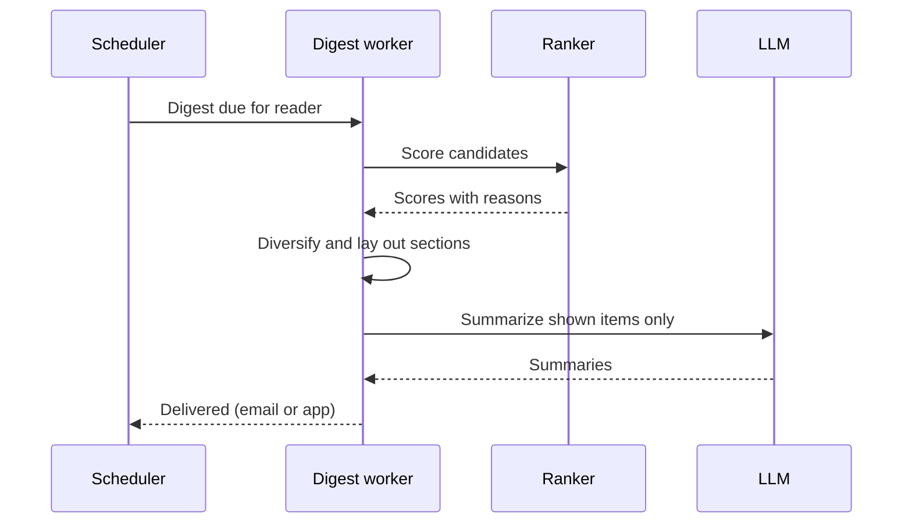
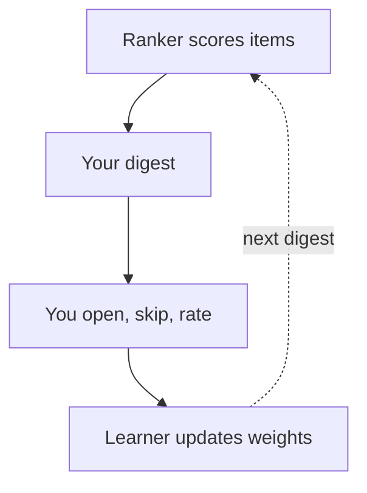

# Architecture

ReadPrism collects your feeds, newsletters and creators, ranks what
arrived for you, and delivers a short daily digest that explains each pick.
This page shows how the pieces fit together.

It runs in two modes, set by `DEPLOYMENT_MODE`:

| Mode | Who it's for | What changes |
|---|---|---|
| `selfhost` (default) | You, on your own server | No plans, quotas or billing. Registration is closed after the first account. |
| `hosted` | A managed multi-user service | Email verification, abuse limits, per-plan quotas and billing. See [Hosted service](HOSTING.md). |

## The big picture

Readers use the web app or the browser extension. Both talk to one API. Slow
work (fetching, embedding, building digests) goes through Redis to background
workers. Everything durable lives in Postgres.

| Piece | What it does | Code |
|---|---|---|
| Web app | Next.js reader, digest and settings | `frontend/` |
| API | FastAPI, everything under `/api/v1` | `backend/app/api/` |
| Workers | Celery, one queue each: `scrape`, `embed`, `digest` | `backend/app/workers/` |
| Scheduler | Celery beat: polls, digests, emails, upkeep | `backend/app/workers/schedules.py` |
| Postgres | Users, feeds, items, vectors (pgvector), digests | `backend/app/models/` |
| Redis | Task broker, cache, rate limits, counters | `backend/app/utils/cache.py` |

Each worker runs one process (`--pool=solo`), so database connections are
never shared across event loops. To add capacity, run more copies of the
worker whose queue is behind. Why: [ADR 0001](adr/0001-celery-solo-pool.md).

## From feed to stored item

- **One fetch per feed.** Subscriptions are per user (`sources`), but polling
  is per feed (`feeds`). A feed followed by a hundred readers is fetched once;
  its HTTP state is copied to each subscriber's row (`ingestion/feeds.py`).
- **Adaptive polling.** Each feed is polled every 15 minutes to 24 hours,
  depending on how often it publishes. Errors back off exponentially and
  `Retry-After` is honoured (`ingestion/schedule.py`).
- **Duplicates** are caught three ways: canonical URL, feed GUID, and
  near-identical text (SimHash).
- **Safe fetching.** Every outbound request resolves the host, refuses
  private addresses, and connects to the checked IP, so DNS rebinding can't
  reach your network (`utils/ssrf.py`, [ADR 0003](adr/0003-safe-fetch.md)).
  JavaScript-only pages are rendered by an isolated browser that can only
  reach the internet through an egress proxy.
- **Platforms.** Substack, Medium, YouTube, Bluesky, Mastodon and GitHub are
  fully supported; blogs and podcasts on a best-effort basis. X, LinkedIn
  and Reddit are not supported and say so in the app.

## Building a digest

**Sections.** The builder (`digest/builder.py`) fills, in order: the lead
stories, *From your creators* (at most two per creator), *Deep reads* (8
minutes or longer), *Discovery* (serendipity picks from outside your usual
sources) and *More from your feeds* until the digest reaches its length.

**Length and timing.** The digest length follows how many items you
actually open (1.25 times a moving average, between 5 and 30), unless you set
it yourself. Digests go out within 15 minutes of your chosen local time.

**Summaries are lazy.** Every item gets a short extract at ingest. A model
summary is written only when the item is shown in a digest or opened in the
reader, so a feed you never read costs nothing. Summaries use the fast
model; story synthesis uses the large one ([which model does
what](DEPLOYMENT.md#which-model-does-what-225)).

## How ranking learns

Each candidate gets eight scores between 0 and 1. A score with no evidence
behind it stays at a neutral 0.5 and is left out of the explanation.

| Signal | What it measures |
|---|---|
| `semantic` | Closeness to the topics in your interest graph |
| `reading_depth` | How far you read similar articles |
| `suggestion` | How often you accept discovery picks like it |
| `explicit_feedback` | Closeness to what you rated up, away from what you rated down |
| `source_trust` | How your reading of this source has gone |
| `content_quality` | Length, citations and depth |
| `temporal_context` | Freshness, less for the fifth story on the same event |
| `novelty` | Distance from what you read in the last 30 days |

- **Weights are personal.** They are trained on pairs from the same digest
  (the item you opened against the one you skipped), which is less noisy
  than raw clicks. Updates are debounced per reader.
- **Diversity.** Before layout, a re-rank (MMR) keeps one topic from taking
  over the digest.
- **Proof it helps.** Part of each digest is interleaved with a newest-first
  ranking, so the app can measure whether personal ranking actually wins.
  Details: [How ranking works](signals.md).

## Accounts, sessions and data safety

- **Sign-in.** The browser holds `httpOnly`, `SameSite=Lax` cookies; every
  change also needs a CSRF token. The extension and scripts use scoped API
  tokens (`rp_…`). More: [Security model](security.md).
- **Migrations** run on start-up under a Postgres advisory lock, so when
  several containers start at once exactly one migrates and the rest wait.
- **Secrets entered in the browser** (the setup screen, readers' own LLM
  keys) are encrypted with a key derived from `SECRETS_ENCRYPTION_KEY`.
- **Hosted only:** email verification, fetch budgets and per-host limits,
  plan quotas and billing through Lemon Squeezy or Paddle
  (`services/billing/`). See [Hosted service](HOSTING.md).

## Watching it run

Queue waits, task runtimes and digest punctuality are recorded per task and
served at `GET /api/v1/metrics/queues` and, for Prometheus, `GET /metrics`
(both need `METRICS_TOKEN`). The optional monitoring profile adds Prometheus,
Grafana and alert rules. See [Monitoring](DEPLOYMENT.md#monitoring).
