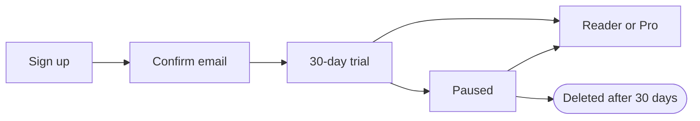

# Hosted service

<p class="lead">How to run Weirling as a managed, multi-user service: plans,
billing, abuse limits and account lifecycle.</p>

Everything here applies only with `DEPLOYMENT_MODE=hosted`. A self-hosted
instance ignores it. Install and operations are the same as for self-hosting:
see [Install & run](DEPLOYMENT.md).

## A reader's journey



| Step | What happens | Setting |
|---|---|---|
| Sign up | Signups are capped per email domain per hour (20 times higher for large mail providers) | `SIGNUP_PER_DOMAIN_PER_HOUR` |
| Confirm email | No email except the confirmation until the link is clicked. Digests are built but not emailed; newsletters are dropped. A magic-link sign-in also confirms. | |
| Trial | No card needed. Emails when it starts, 5 days before it ends, and when it ends. | `BILLING_TRIAL_DAYS`, `TRIAL_ENDING_NOTICE_DAYS` |
| Trial over, no plan | The account is **paused**: read-only, no feed updates, no digests, no AI summaries. Reading, export, subscribing and deleting still work. A reminder goes out 7 days before deletion; the account and its data are deleted 30 days after the pause began. Subscribing at any point ends the pause. A lapsed subscription pauses the same way. | `HOSTED_PAUSED_DELETE_DAYS` (0 = never), `HOSTED_DELETE_REMINDER_DAYS` |
| Subscribe | Checkout through the payment provider; the plan applies when its webhook arrives | See [Billing](#billing) |

## Plans and quotas

| Plan | Price | Feeds | AI summaries a day | Newsletters a day | Manual digest builds a day |
|---|---|---|---|---|---|
| Trial (30 days, no card) | Free | 2,000 | 1,000 | 300 (150 MB) | 12 |
| **Reader** | $6/month or $54/year | 500 | 200 | 100 (50 MB) | 6 |
| **Pro** | $12/month or $108/year | 2,000 | 1,000 | 300 (150 MB) | 12 |

There is no free hosted plan (D-18): the trial has everything in Pro, and an
account with no plan after it is paused (see above).

### Pro-only features

Pro (and the trial) also gets these; self-host has all of them (D-19, #246):

| Feature | Without Pro |
|---|---|
| Twice-daily digests | Choosing it is refused; an existing setting runs as daily after a downgrade |
| Story synthesis | Same-story cards still list the other sources, without the AI-written briefing; the creator summary is refused |
| API and MCP access | API tokens work only for the browser extension, which every plan can use |
| Priority fetching | Feeds keep their adaptive schedule; a feed with a Pro reader goes first in each polling run and is checked at least every `HOSTED_PRO_MAX_POLL_MINUTES` (60) after a clean poll |

- **Prices are set in the payment provider** (D-18); the app only knows the
  checkout links.
- **Defaults** are `DEFAULT_PLAN_QUOTAS` in `backend/app/config.py`; 0 means
  unlimited.
- **Change a plan** with `HOSTED_PLAN_QUOTAS`, JSON merged over the defaults:
  `HOSTED_PLAN_QUOTAS={"pro": {"sources": 3000}}`.
- **Change one account:**

    ```bash
    cd backend && python scripts/set_quota.py reader@example.com sources=1000
    python scripts/set_quota.py reader@example.com            # show its limits
    python scripts/set_quota.py reader@example.com --clear    # remove overrides
    ```

- **Daily allowances reset at midnight UTC.** When AI summaries run out, the
  digest keeps the extract. Scheduled digests always run and never count as
  builds.
- **Readers see it all** in Preferences → Plan: the plans side by side,
  their limits and today's use.

## Readers' own LLM keys

With `SECRETS_ENCRYPTION_KEY` set, a reader can add their own key in
Preferences → Your own AI key. Their summaries then run on their provider
account, outside the plan's AI allowance.

- Only providers in `BYOK_ALLOWED_BASE_URLS` are accepted (Groq, OpenAI,
  OpenRouter, Together, Fireworks and DeepInfra by default), so a key can't
  make the server call any other host.
- The key is tested with one tiny request, then stored encrypted with a key
  derived from `SECRETS_ENCRYPTION_KEY` (never `SECRET_KEY`).
- It is never returned by the API (only its last 4 characters) and is
  redacted from logs.
- It is used only for that reader's summaries, with no fallback to the
  instance's provider.
- Changing `SECRETS_ENCRYPTION_KEY` makes stored keys unreadable; readers
  then add theirs again.

A discounted plan for these readers is a pricing decision (#138). Add it as
another plan when you decide.

## Billing

Weirling supports two billing models on hosted instances:

- **Merchant of record (Lemon Squeezy or Paddle)**: The provider acts as the merchant of record and handles VAT, GST, and sales tax filing across countries.
- **Payment gateway (Razorpay)**: Razorpay operates as a payment gateway, not a merchant of record (Decision D-25). The instance operator is directly responsible for filing GST and any applicable sales tax.

### Configuring Lemon Squeezy or Paddle

1. Set `BILLING_PROVIDER` (`lemonsqueezy` or `paddle`) and
   `BILLING_WEBHOOK_SECRET`.
2. Point the provider's webhook at
   `https://<api>/api/v1/billing/webhook/<provider>`, subscribed to
   subscription events.
3. Create a product for each plan (Reader, Pro) with a monthly and a yearly
   price, and set their checkout links (Lemon Squeezy) or price ids (Paddle):

    | Setting | Plan | Billing period |
    |---|---|---|
    | `BILLING_CHECKOUT_READER_MONTHLY` | Reader | Monthly |
    | `BILLING_CHECKOUT_READER_YEARLY` | Reader | Yearly |
    | `BILLING_CHECKOUT_PRO_MONTHLY` | Pro | Monthly |
    | `BILLING_CHECKOUT_PRO_YEARLY` | Pro | Yearly |

    A plan with no link isn't offered. The older `BILLING_CHECKOUT_MONTHLY`
    and `_YEARLY` still work as Reader's links.

4. List the ids that grant each plan in `BILLING_READER_PRICE_IDS` and
   `BILLING_PRO_PRICE_IDS` (and `BILLING_TEAM_PRICE_IDS` for hand-granted Team
   accounts). An id that isn't listed never upgrades anyone.
5. Set `BILLING_API_KEY`. Paddle uses it for checkout and portal sessions;
   both providers use it to cancel a subscription when an account is deleted.
   Test Paddle with `BILLING_SANDBOX=true`.

### Configuring Razorpay

1. Set `BILLING_PROVIDER=razorpay`.
2. Set API credentials and webhook secret:
   ```bash
   RAZORPAY_KEY_ID=rzp_live_...
   RAZORPAY_KEY_SECRET=...
   RAZORPAY_WEBHOOK_SECRET=...
   ```
3. Set the plan id for the Pro plan:
   ```bash
   RAZORPAY_PLAN_ID_PRO=plan_...
   ```
   Or set `BILLING_PRO_PRICE_IDS` with comma-separated plan ids.
4. Point your Razorpay webhook to:
   `https://<api>/api/v1/billing/webhook/razorpay`
   Subscribe to `subscription.activated`, `subscription.charged`,
   `subscription.pending`, `subscription.halted`, `subscription.cancelled`,
   `subscription.completed`, and `subscription.expired`.
5. Tax responsibility: As Razorpay is a payment gateway, the operator must
   account for GST and foreign taxes on all subscription revenue.
6. Customer portal: Razorpay has no hosted customer portal. The preferences
   UI detects this (`portal_url` is null) and displays a support contact link
   so users can manage their subscription via email. Account deletion cancels
   the active subscription immediately via Razorpay's Subscriptions API.

### How billing behaves

- **Webhooks** are verified, recorded once (a replay does nothing) and
  applied in order, so a late, older event can't bring back a cancelled plan.
- **A plan lapses** at its expiry date, with no scheduled job.
- **Switching plans** happens in the provider's portal (Manage billing),
  which prorates, or via support for Razorpay. Checkout refuses a second
  subscription.

## Abuse limits

| Limit | Default | Setting |
|---|---|---|
| Fetches per account per hour | 300 | `HOSTED_FETCH_BUDGET_PER_HOUR` |
| Polls of one host per hour, all accounts | 120 | `HOSTED_HOST_POLLS_PER_HOUR` |
| One account's feeds on the same host | 10 | `HOSTED_MAX_SOURCES_PER_HOST` |
| Inbound newsletters per account per day | 100 (25 MB) | `HOSTED_INBOUND_PER_DAY`, `HOSTED_INBOUND_MB_PER_DAY` |

A feed poll counts against every account that follows it, and is skipped
only when all of them are over budget. These caps apply on top of the plan
quotas.

## Deleting an account

1. The subscription is cancelled first.
2. The data is erased even if the cancellation fails.
3. The reader gets a confirmation email saying whether billing was cancelled.

!!! warning "When a cancellation fails"
    The attempt is recorded in `billing_events` (provider and subscription
    id only) and the `billing_cancel_failed` alert fires for 7 days. Cancel
    the subscription by hand in the provider's dashboard.
