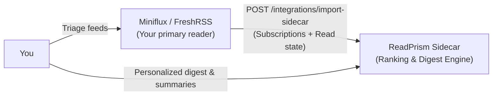

# Use ReadPrism as a ranking sidecar for Miniflux or FreshRSS

<p class="lead">Keep your existing self-hosted RSS reader as your daily firehose,
while ReadPrism runs alongside it to score, rank, and summarize your top articles
into a focused digest.</p>

If you already use [Miniflux](https://miniflux.app/) or [FreshRSS](https://freshrss.org/),
you don't have to abandon your setup or migrate away. With **sidecar mode**
([ADR 0007](adr/0007-reader-api-compat.md)), ReadPrism imports your subscriptions
and reading history directly via their native APIs. Your primary reader stays
your inbox for full chronological browsing, while ReadPrism builds your
personalized daily digest.



---

## What the import does

ReadPrism exposes a dedicated integration endpoint:

```http
POST /api/v1/integrations/import-sidecar
```

When you trigger a sidecar import, ReadPrism:

1. **Connects to your reader's API** using temporary, in-memory credentials.
2. **Fetches all active feed subscriptions** (paginated in batches of 200).
3. **Creates new `Source` records** in ReadPrism with an initial trust weight of
   `0.45` (identical to curated starter packs).
4. **Skips feeds you already have**, preserving your accumulated trust history.
5. **Pulls recent read state (Miniflux):** matches recently read entries against
   already-ingested items in ReadPrism, creating initial read interactions so
   your ranking model starts warm rather than cold.

Credentials are used **strictly in-memory** for the duration of the request.
They are never saved to disk, stored in the database, or recorded in server logs.

---

## Step-by-step guide

### 1. Miniflux

Miniflux provides a clean REST API authenticated by an API token.

#### Step A: Generate an API token in Miniflux
1. Open your Miniflux web interface.
2. Navigate to **Settings** → **API Keys**.
3. Click **Create a new API key**.
4. Label it `ReadPrism` and click **Save**.
5. Copy the generated API token (it will only be displayed once).

#### Step B: Run the sidecar import
You can trigger the import from ReadPrism's **Sources** page, or call the API directly:

```bash
curl -X POST https://<your-readprism-host>/api/v1/integrations/import-sidecar \
  -H "Authorization: Bearer <your-readprism-token>" \
  -H "Content-Type: application/json" \
  -d '{
    "provider": "miniflux",
    "base_url": "https://miniflux.example.com",
    "token": "YOUR_MINIFLUX_API_TOKEN"
  }'
```

**Response:**
```json
{
  "feeds_added": 42,
  "feeds_existing": 3,
  "read_marked": 28,
  "errors": []
}
```

---

### 2. FreshRSS

FreshRSS exposes a Google Reader-compatible API (`greader.php`).

#### Step A: Enable API access in FreshRSS
1. Open your FreshRSS web interface.
2. Go to **Settings** (gear icon) → **Profile**.
3. Under the **API management** section:
   - Check the box to enable API access.
   - Set an **API Password** (or app password).
   - Click **Submit**.

#### Step B: Run the sidecar import

```bash
curl -X POST https://<your-readprism-host>/api/v1/integrations/import-sidecar \
  -H "Authorization: Bearer <your-readprism-token>" \
  -H "Content-Type: application/json" \
  -d '{
    "provider": "freshrss",
    "base_url": "https://freshrss.example.com",
    "username": "alice",
    "app_password": "YOUR_FRESHRSS_API_PASSWORD"
  }'
```

**Response:**
```json
{
  "feeds_added": 35,
  "feeds_existing": 0,
  "read_marked": 0,
  "errors": []
}
```

---

## Private network & homelab setup

By default, ReadPrism enforces **strict public HTTPS** and SSRF protections on
all outgoing connections. If your Miniflux or FreshRSS instance is hosted on a
local private subnet (e.g. `http://192.168.1.50:8080` or `http://miniflux.lan`):

1. Set these environment variables in your ReadPrism `.env`:
   ```bash
   DEPLOYMENT_MODE=selfhost
   SIDECAR_ALLOW_PRIVATE_HTTP=true
   ```
2. When enabled, ReadPrism permits plain HTTP and private IP addresses
   **only** for the exact host specified in `base_url`. This option is disabled
   and ignored in hosted mode (`DEPLOYMENT_MODE=hosted`).

---

## What is and isn't synced

| Feature | Miniflux | FreshRSS | Details |
|---|---|---|---|
| **Feed subscriptions** | ✅ Yes | ✅ Yes | Feed URLs and titles imported as `Source` records. |
| **Existing feeds preserved** | ✅ Yes | ✅ Yes | Deduplicated by URL; existing feed trust is untouched. |
| **Warm-up read history** | ✅ Yes (up to 100) | ❌ No | Miniflux read articles mark matching items opened at 90% completion. |
| **Two-way sync** | ❌ No | ❌ No | ReadPrism does not push read state or stars back to your reader. |
| **Continuous sync** | ❌ No | ❌ No | Imports are on-demand. Re-run import whenever you add new feeds. |
| **Folders / categories** | ❌ No | ❌ No | Feeds are imported into your unified ReadPrism source library. |

---

## Limits and quotas

- **Feed pagination:** Miniflux feeds are fetched in pages of 200 up to 1,000 feeds.
- **Hosted quotas:** On a hosted instance, feed limits depend on your plan quota
  (e.g. 500 on Trial/Reader, 2,000 on Pro, 30 on Free limits). Self-host has no feed cap.
- **Response size:** Payloads from the upstream reader are capped at 2 MB per request
  to prevent memory pressure.
- **Redirects:** Outgoing requests disallow HTTP redirects (`max_redirects=0`) to
  prevent authorization headers from leaking across origins.
