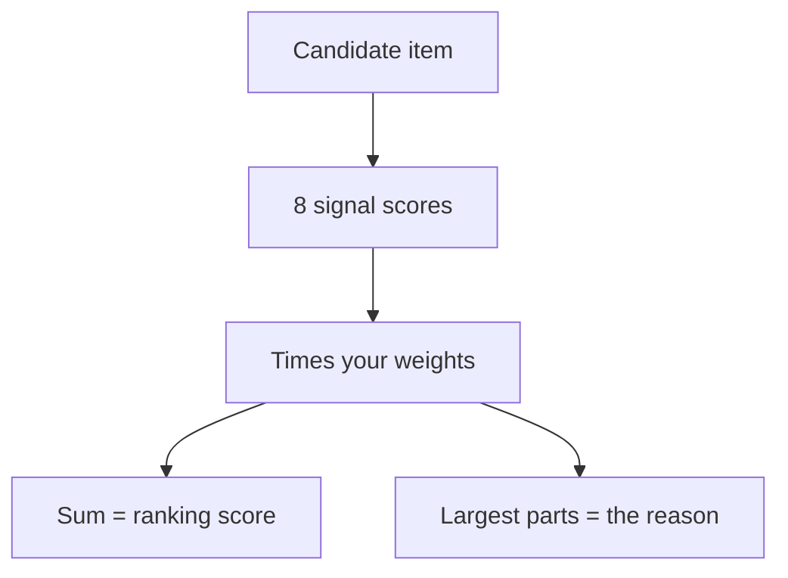

# How ranking works

Every candidate item gets eight scores, each between 0 and 1,
computed before you see it. Your own weights combine them into one score, and
the same numbers explain the pick.

## The signals

| Signal | What it measures |
|---|---|
| `semantic` | How close the item is to the main topics in your interest graph (importance-weighted best cosine match) |
| `reading_depth` | How far you're likely to read it, judged from other items of the same source and length. The item's own history is left out. |
| `suggestion` | Higher for items that came from discovery |
| `explicit_feedback` | Thumbs, saves and skips. A skip only counts if you viewed the digest. |
| `source_trust` | How your reading of this source has gone recently. New sources start neutral. |
| `content_quality` | Length, links, citations and code, adjusted to how much you finish at that length |
| `temporal_context` | Freshness over long, medium and short horizons, lower for the fifth story on the same event |
| `novelty` | Distance from what you already read |

## From signals to a score

- **Contribution** = your weight for a signal × the signal's value.
- The contributions add up to the item's score, which is then clamped to
  the range 0 to 1. Because of that clamp, the stored score can differ
  slightly from the sum.
- **Missing evidence** leaves a signal at a neutral 0.5. It doesn't
  appear in the explanation and doesn't push your weights either way.
- **The explanation** names the largest contributions, in plain words. It
  never claims a reason the numbers don't show.

## How your weights change

Weights start from sensible defaults and are trained on pairs from the
same digest: the item you opened against one you skipped. Comparing items
shown side by side is fairer than counting raw clicks, because both had the
same chance to be seen. Updates are batched per reader so one session doesn't
swing the ranking.

More context: [Architecture → How ranking learns](ARCHITECTURE.md#how-ranking-learns)
and [Feedback mapping](feedback-mapping.md).
